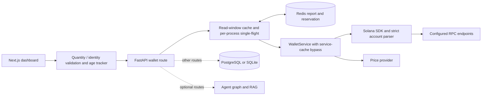

# Architecture and implementation status

[English home](../../README.en.md) · [Wallet contract](API.md)

## Data ownership

The parser validates typed SDK responses, raw units, mint/owner keys and the Legacy Token Program. WalletService constructs exact token quantities, retains account identity, and validates the batch before returning it. Multiple accounts for one mint remain separate; identical account repeats can collapse, while conflicting repeats fail.

The API exposes JSON string quantities and slots alongside legacy approximate fields. The response's token slot covers the token-account read. SOL and token calls do not form one atomic cross-account snapshot, and an empty token list currently has an unknown token context (`null`).

The report cache owns read-window timing and publication eligibility. Its per-process task map merges overlapping requests for one key in that process. Each rebuild bypasses the older blockchain in-memory cache. Across processes, a UUID reservation is recorded before reading and compared atomically with the report write in Redis Lua. The later Redis reservation can invalidate an older writer even if its reported balance is smaller.

The client owns UI request ordering and local age estimation. A current wallet request can replace the view; older completions cannot. Report age grows while the page remains open, and clock anomalies invalidate it. Timer/focus/visibility callbacks are best effort rather than a hard real-time guarantee.

## Status and boundaries

| Area                 | Current state                                                              | Remaining verification or work                                               |
| -------------------- | -------------------------------------------------------------------------- | ---------------------------------------------------------------------------- |
| Raw token quantities | Exact construction and fixed-point JSON/display text                       | Explicit precision/rounding rules for subsequent valuation arithmetic        |
| Account identity     | Legacy Token Program metadata and batch validation                         | Token-2022 decoding; stronger empty-response context representation          |
| USD values           | Existing approximate compatibility fields                                  | Missing-price semantics and independent quote freshness                      |
| Cache publication    | Single-primary Redis conditional publication; real process race test       | Failover, state rollback, Cluster and cross-region recovery                  |
| Frontend             | Full build/type/lint checks; pure client logic and earlier card SSR checks | Browser lifecycle, physical sleep, usability and end-to-end provider testing |
| Database             | Existing models, initialization and infrastructure                         | Production migrations, backup/restore and workload validation                |
| Authentication       | Login/verify routes currently return TODO responses                        | Wallet signature verification and authorization design                       |
| AI workflows         | Existing graph, prompts and RAG modules; lazy API imports                  | Reconcile dependency manifests and validate optional provider integration    |
| Deployment           | Existing Compose/Docker configuration                                      | Full-stack smoke test, environment hardening and operational monitoring      |

The design currently chooses a clear rejection over restoring an older task's publication rights when a newer reservation fails. Existing valid cached reports may remain readable; a subsequent refresh creates a new reservation. A timed-out publish reply is an unknown result, not proof that Redis did not execute it.

## Review entry points

- `services/blockchain/transport/token_accounts.py`: typed response validation.
- `services/blockchain/services/wallet_service.py`: quantity construction, identity and cache bypass.
- `apps/api/app/core/wallet_report_cache.py`: read windows and in-flight reads.
- `apps/api/app/core/report_publication.py`: Redis atomic admission check.
- `apps/web/src/lib/`: exact quantities, identity, request ordering and report age.
- `apps/web/src/app/dashboard/page.tsx`: integration of current report and age into the UI.

Start with a concrete raw amount and follow it through these boundaries before extending the service.
