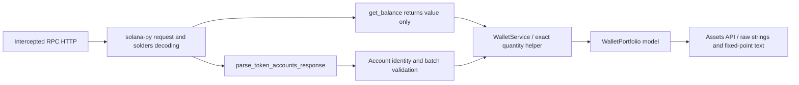

# Wallet field provenance

[English home](../../README.en.md) · [Contribution and CI audit](REVIEW_CHECKS.md)

The trace is anchored to the wallet implementation at `5df8a31045c13e75b537dee1331399db8cc77947`, using solana-py 0.30.2, solders 0.18.1 and httpx 0.23.3. The diagnostic adds observation wrappers and substitutes HTTP/prices/Redis only for an offline example; it does not alter production parsing or quantity rules.

## Three upstream values

| Application value   | RPC source                                                                                               | Local path and representation                                                                                                                  |
| ------------------- | -------------------------------------------------------------------------------------------------------- | ---------------------------------------------------------------------------------------------------------------------------------------------- |
| Native `lamports`   | `getBalance.result.value`, a JSON u64 number                                                             | `GetBalanceResp.value` → Python int → `EnhancedRPCClient.get_balance` → `SolBalance.lamports` → API `sol_balance_raw` string                   |
| Token `balance_raw` | `getTokenAccountsByOwner.result.value[i].account.data.parsed.info.tokenAmount.amount`, an integer string | Typed outer response, generic parsed dictionary → `_raw_amount` validates canonical ASCII/u64 → Python int → TokenAccount → API integer string |
| Token `decimals`    | The same `tokenAmount.decimals` field                                                                    | Generic parsed value → strict integer/u8 checks → TokenAccount integer → API integer                                                           |

Native SOL always uses scale 9. Mint decimals describe the token's scale; SolonAI receives them from the RPC's parsed response. It does not independently request and decode the Mint account in this wallet path. Checking range and same-mint batch consistency is not independent verification of RPC truth.

The underlying [Mint state contains decimals](https://solana.com/docs/tokens/basics/create-mint); a [Token Account stores its mint, token authority and amount](https://solana.com/docs/tokens/basics/create-token-account). The application's input is the RPC's `jsonParsed` projection of these data, not a separate locally decoded Mint proof.

## Two lamport balances and two owners

The synthetic example intentionally contains three different quantities:

```text
getBalance.result.value                         = 1000000001 lamports
token account outer account.lamports            = 2039280 lamports
token account parsed tokenAmount.amount         = "1250000" token units
tokenAmount.decimals                            = 6
```

They yield 1.000000001 native SOL and 1.250000 tokens. The outer token account's SOL funding is not the token amount and is not automatically added to the native wallet balance. The numbers are fixtures, not statements of actual holdings or a universal account funding requirement.

`account.owner` is the account's program owner; `parsed.info.owner` is the token authority checked against the queried wallet. The response entry's `pubkey` identifies the token account, while `parsed.info.mint` identifies the token. The parser validates and retains these distinctions.

## Follow the code



1. [Native RPC wrapper](https://github.com/fangnster/SolonAI/blob/5df8a31045c13e75b537dee1331399db8cc77947/services/blockchain/transport/rpc_client.py#L100) returns the typed `.value`. It discards that response's context slot.
2. [Token RPC wrapper](https://github.com/fangnster/SolonAI/blob/5df8a31045c13e75b537dee1331399db8cc77947/services/blockchain/transport/rpc_client.py#L118) requests Legacy Token Program accounts with `jsonParsed`. SDK requests execute inside the retry loop; application parsing runs afterwards.
3. [Business parser](https://github.com/fangnster/SolonAI/blob/5df8a31045c13e75b537dee1331399db8cc77947/services/blockchain/transport/token_accounts.py#L38) ignores presentation `uiAmount`/`uiAmountString`, validates raw units and scale, and carries the token response's context slot.
4. [Service normalization](https://github.com/fangnster/SolonAI/blob/5df8a31045c13e75b537dee1331399db8cc77947/services/blockchain/services/wallet_service.py#L32) rejects conflicts and inconsistent scales for one mint in the same batch. The shared helper builds Decimal quantities directly from validated raw units and scale.
5. [API projection](https://github.com/fangnster/SolonAI/blob/5df8a31045c13e75b537dee1331399db8cc77947/apps/api/app/api/v1/assets.py#L173) serializes raw units/slots as strings and constructs exact fixed-point text. Legacy numeric and USD fields remain approximate.

The fixture native slot is 424241 and the token response slot is 424242. The output token slot does not certify a shared native/token snapshot. Report read-window metadata does not restore the discarded native context or certify price freshness.

## Run the actual SDK-to-API trace

With the API Python dependencies installed, run from the repository root:

```bash
.venv/bin/python scripts/trace_wallet_sources.py --case baseline --out .wallet-report-results-trace
.venv/bin/python scripts/trace_wallet_sources.py --case all --out .wallet-report-results-trace-all
```

Output directories must be new. Each case writes its synthetic RPC JSON and `trace.json`, including actual request parameters, decoded SDK types, parser records, wallet model and API response. No external RPC, signing, socket server, real database or real Redis is used. Redis is a protocol double; the separate wallet regression entry point verifies real Redis semantics.

The SDK observation seam uses private provider/session members, so the script checks its pinned SDK versions and is not a production extension interface.

| Case                             | HTTP / boundary                                                      | Relevant request count |
| -------------------------------- | -------------------------------------------------------------------- | ---------------------: |
| `baseline`, `ui-disagrees`       | 200; raw units remain authoritative                                  | One native + one token |
| `raw-invalid`, `decimals-string` | 500; business parser rejects after SDK decoding                      |              One token |
| `native-overflow`                | 500; typed SDK response fails inside the broad retry loop            |           Three native |
| `account-lamports-overflow`      | 500; typed outer token response fails inside retry                   |            Three token |
| `decimals-conflict`              | 500; individual records parse, service rejects the batch             |              One token |
| `different-decimals`             | 200; a well-formed single response with scale 9 displays 0.001250000 | One native + one token |

The last case deliberately changes only the RPC's claim about decimals while keeping the mint address. It demonstrates the absence of independent Mint verification, not a legitimate on-chain precision change. Expected 500 cases are successful diagnostic scenarios when their assertions match; a missing import is not equivalent evidence.
